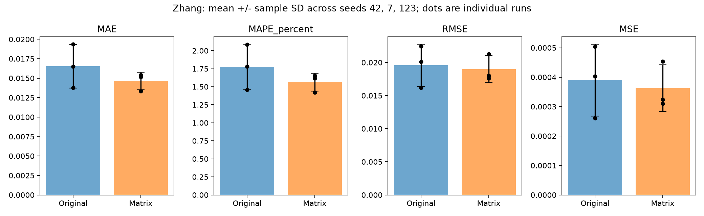
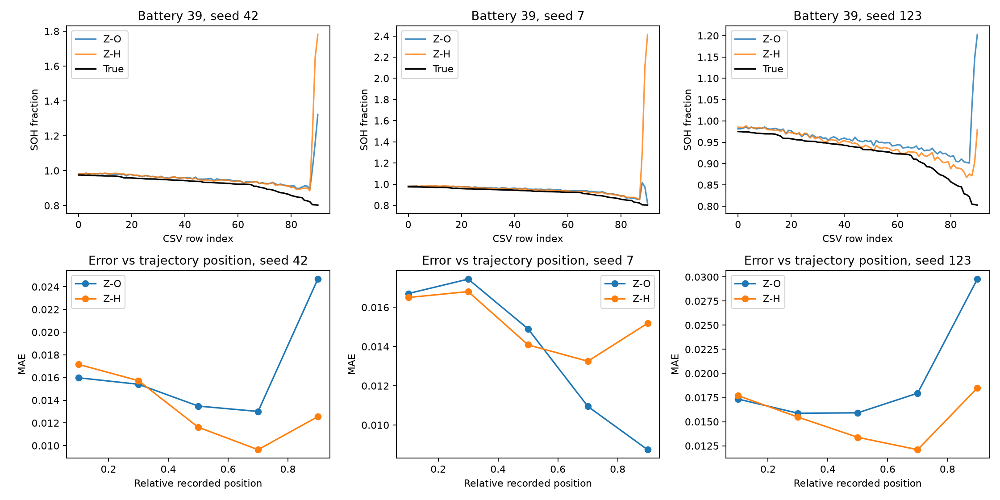
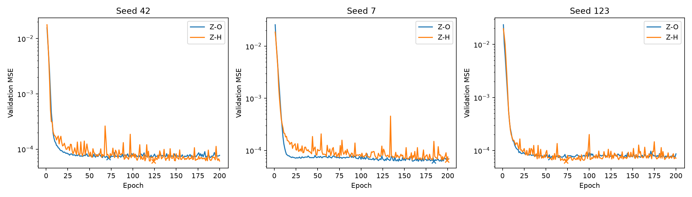

# MIT comparison: Wang and Zhang three-seed results

Latest stage: Zhang robustness only, seeds 7 and 123 added to existing seed 42. Four new runs completed. No Wang rerun, architecture changes, tuning or ablation. Each arm completed 200 epochs; checkpoint selection used its own lowest validation mixed-prediction MSE.

## Frozen protocol and verification

HD-SOH-v1 is unchanged: 71/18/36 MIT train/validation/test batteries; 42,784/13,585/29,083 pairs; split seed 420; SOH=capacity/1.1; train-only min-max; causal feature filling and 16-cycle windows. Test battery/row keys and labels are identical in all six Zhang runs and match the existing Wang protocol. All metrics were independently recalculated from saved predictions.

Zhang is the existing BatLiNet-inspired SOH adaptation, not the original paper's lifetime model. Original and matrix use the same existing classes as seed 42 (9,313 versus 18,529 parameters). Adam lr=0.001, batch 512, no scheduler or early stopping; losses, mixture weight 0.5 and two evaluation references are unchanged. CPU thread counts remain 8.

Training initialization and batch order follow seeds 42/7/123; training-reference RNG is 10000+seed. Within each seed, original/matrix receive the same batch-order and training-reference schedule. Validation and test references remain frozen across ALL seeds (RNG 20042 and 30042), not merely within each paired seed. Saved reference IDs and clamped rows were verified identical. Only training batteries provide reference labels. This isolates training randomness from evaluation-reference randomness.

MAE/RMSE use SOH fractions; MSE uses squared fractions; MAPE is percent. Mean +/- SD is computed over three per-run pooled metrics, with sample SD (ddof=1). Positive improvement means matrix is better. Paired improvement is averaged after calculating each seed separately; ratio-of-mean-error improvement is separately saved in final_comparison.csv and metric_improvements.csv. These are different statistics.

## Zhang three-seed metrics

| metric | original mean +/- SD | matrix mean +/- SD | paired improvement % mean +/- SD |
| --- | --- | --- | --- |
| MAE | 0.01654047 +/- 0.002805 | 0.01464653 +/- 0.001136 | +9.731 +/- 17.340 |
| MAPE_percent | 1.774495 +/- 0.3147 | 1.564349 +/- 0.1241 | +9.946 +/- 18.180 |
| RMSE | 0.0195712 +/- 0.003178 | 0.01896862 +/- 0.00203 | +0.153 +/- 27.882 |
| MSE | 0.000389767 +/- 0.0001221 | 0.0003625544 +/- 7.927e-05 | -4.877 +/- 59.828 |

## Individual runs

| arm | seed | MAE | MAPE_percent | RMSE | MSE | training_runtime_seconds | total_arm_seconds | best_epoch | stopping_epoch |
| --- | --- | --- | --- | --- | --- | --- | --- | --- | --- |
| Z-O | 42 | 0.01650476 | 1.779178 | 0.0200833 | 0.0004033387 | 865.9777 | 1051.822 | 72 | 200 |
| Z-H | 42 | 0.01334346 | 1.422424 | 0.01760358 | 0.000309886 | 1405.793 | 1667.417 | 124 | 200 |
| Z-O | 7 | 0.01375387 | 1.457508 | 0.01616781 | 0.0002613981 | 899.0147 | 1091.608 | 184 | 200 |
| Z-H | 7 | 0.01516786 | 1.61844 | 0.02130082 | 0.000453725 | 1415.184 | 1680.289 | 199 | 200 |
| Z-O | 123 | 0.01936279 | 2.086799 | 0.0224625 | 0.000504564 | 915.4174 | 1113.133 | 55 | 200 |
| Z-H | 123 | 0.01542825 | 1.652183 | 0.01800145 | 0.0003240523 | 1207.211 | 1432.337 | 73 | 200 |

The four additional runs used 73.95 training minutes and 88.62 total-arm minutes (including validation, evaluation and saving). Setup/analysis are outside those totals. All checkpoints passed exact validation-prediction reload checks.

## Per-battery consistency

| seed | batteries_improved | batteries_worsened | early_batteries_worsened | largest_excess_battery |
| --- | --- | --- | --- | --- |
| 42 | 34 | 2 | 28 | 2018-04-12_battery-39 |
| 7 | 8 | 28 | 19 | 2018-04-12_battery-33 |
| 123 | 36 | 0 | 21 | none (all batteries improve) |

Comparing each battery's three-seed mean MAE, 31/36 improve and 5/36 worsen. All official metrics include all batteries; no outcome-based exclusions were applied.

## Battery 39 across seeds

| seed | battery39_original_MAE | battery39_matrix_MAE | battery39_improvement_percent | battery39_positive_excess_share_percent | battery39_matrix_squared_error_share_percent | battery39_excess_rank |
| --- | --- | --- | --- | --- | --- | --- |
| 42 | 0.03376329 | 0.0447742 | -32.61209 | 74.66049 | 21.05058 | 1 |
| 7 | 0.02259121 | 0.05322042 | -135.5802 | 4.996131 | 34.70818 | 9 |
| 123 | 0.03371642 | 0.01849053 | 45.15866 | 0 | 0.8360567 | N/A |

| seed | arm | battery39_MAE | battery39_squared_error_share_percent | max_absolute_error | worst_row | true_at_worst | prediction_at_worst |
| --- | --- | --- | --- | --- | --- | --- | --- |
| 42 | Z-O | 0.03376329 | 4.328437 | 0.5197627 | 90 | 0.8027175 | 1.32248 |
| 42 | Z-H | 0.0447742 | 21.05058 | 0.9787193 | 90 | 0.8027175 | 1.781437 |
| 7 | Z-O | 0.02259121 | 1.453116 | 0.2090179 | 88 | 0.8046861 | 1.013704 |
| 7 | Z-H | 0.05322042 | 34.70818 | 1.611263 | 90 | 0.8027175 | 2.413981 |
| 123 | Z-O | 0.03371642 | 2.78755 | 0.3999402 | 90 | 0.8027175 | 1.202658 |
| 123 | Z-H | 0.01849053 | 0.8360567 | 0.1764786 | 90 | 0.8027175 | 0.9791961 |

Excess-absolute-error share uses the sum of positive excess across worsened batteries as denominator; squared-error share uses the entire matrix test set. Averages can hide a few extreme samples, so the maximum error and exact row/true/predicted SOH are reported separately. Battery 39's late input distribution shift was documented in the seed-42 analysis; this analysis does not establish a causal mechanism.

## Early-cycle robustness

| seed | early_original_MAE | early_matrix_MAE | early_matrix_bias | early_batteries_worsened |
| --- | --- | --- | --- | --- |
| 42 | 0.01598322 | 0.01716194 | 0.01714751 | 28 |
| 7 | 0.01670581 | 0.01650401 | 0.01647129 | 19 |
| 123 | 0.01734934 | 0.01770409 | 0.01768482 | 21 |

Early means the first 20% of each recorded CSV trajectory. Recorded length is used only for retrospective grouping, never as a model input or normalization scale. Positive signed bias means overprediction. Compare both pooled early error and the number of affected batteries rather than assuming uniform behavior.

## Training stability

| seed | arm | best_epoch | final_to_best_validation_ratio | postwarmup_validation_jumps_over_5x |
| --- | --- | --- | --- | --- |
| 42 | Z-O | 72 | 1.113932 |  |
| 42 | Z-H | 124 | 1.014361 |  |
| 7 | Z-O | 184 | 1.145206 |  |
| 7 | Z-H | 199 | 1.171812 | 134 |
| 123 | Z-O | 55 | 1.18794 |  |
| 123 | Z-H | 73 | 1.150463 |  |

The jump rule is descriptive: validation MSE >5 times the previous epoch after epoch 30. Persistent failure requires inspecting recovery and final/best ratios, not just a spike flag.

## Wang reference results (unchanged; no reruns)

| metric | W-O mean +/- SD | W-H mean +/- SD |
| --- | --- | --- |
| MAE | 0.006777026 +/- 0.00144 | 0.009958112 +/- 0.00296 |
| MAPE_percent | 0.7284093 +/- 0.1559 | 1.067587 +/- 0.3287 |
| RMSE | 0.008803757 +/- 0.001437 | 0.01766041 +/- 0.0101 |
| MSE | 7.888363e-05 +/- 2.65e-05 | 0.0003799181 +/- 0.0004146 |

Wang per-run and per-battery results remain in wang_three_seed/. The complete previous report, including Wang interpretation and the Zhang seed-42 analysis, is preserved in zhang_shared_seed_7/previous_analysis_summary.md. Existing predictions, checkpoints and individual-stage reports are not overwritten.

## Interpretation of the completed robustness check

The matrix advantage is seed-dependent. MAE improvements for seeds 42, 7 and 123 are +19.15%, -10.28% and +20.32%; all four pooled metrics favor matrix in seeds 42 and 123 but favor original in seed 7. Battery improvement counts are 34/36, 8/36 and 36/36. Comparing each battery's mean MAE across seeds gives 31/36 improved, but this does not make the gain consistent in every run.

The ratio of mean errors gives +11.45% MAE, +11.84% MAPE, +3.08% RMSE and +6.98% MSE improvement. However, mean paired percentage improvements are +9.73%, +9.95%, +0.15% and -4.88% respectively, with large sample SDs. The MSE sign difference is legitimate: averaging ratios weights each seed relative to its own original error, whereas taking the ratio of mean errors is a different aggregation. Seed 7 has a low original MSE and a large relative deterioration. Both definitions are reported to avoid presenting the aggregate as uniform success.

Battery 39 remains a serious but seed-dependent robustness concern. Matrix MAE is 0.04477, 0.05322 and 0.01849 for seeds 42/7/123, compared with original 0.03376, 0.02259 and 0.03372. Matrix is worse in the first two seeds and improves by 45.16% in seed 123. Its maximum sample error is 0.97872, 1.61126 and 0.17648 SOH units respectively. At row 90 (true SOH 0.802718), matrix predicts 1.781437, 2.413981 and 0.979196. Battery 39 contributes 21.05%, 34.71% and 0.84% of matrix squared error. The severe tail is reproducible in two seeds but is not inevitable in every initialization.

Seed 7 is not explained solely by Battery 39: 28/36 batteries worsen in full-trajectory MAE, and Battery 33 is the largest contributor to excess absolute error. Battery 39 ranks ninth by additive excess absolute error but dominates matrix squared error because a few very large errors are heavily penalized. Seed 123 has no positive excess-error contributor because every battery improves; its excess rank is not applicable.

Early-cycle weakness is not universal across seeds. Pooled early MAE changes by +7.37%, -1.21% and +2.04% (positive means worse), with 28, 19 and 21 of 36 batteries worsening early. All six early signed biases are positive: both representations tend to overpredict early SOH. Thus a broad early bias persists, but matrix is not worse in pooled early MAE in every seed; seed 7 has a small pooled improvement despite 19 batteries worsening.

No Zhang seed exhibits the persistent training collapse observed in Wang matrix. Final/best validation MSE ratios are 1.01-1.17 for matrix and 1.11-1.19 for original. Seed-7 matrix has a >5x post-warmup jump at epoch 134, but recovers and reaches its best at epoch 199. Stability of training therefore does not guarantee robust held-out predictions: the Battery-39 failures still occur at validation-selected checkpoints.

Conclusion: the three-seed averages support a modest MAE/MAPE benefit, but the current matrix pipeline is not a reliably superior replacement. RMSE/MSE gains are small and inconsistent, and catastrophic local errors remain sensitive to training randomness. Three seeds on one fixed test batch are exploratory evidence, not a significance claim. No architecture changes, clipping, data exclusions, tuning or ablation were performed. All requested training is complete and stopped.

## Limits and artifacts

Three training seeds on one fixed held-out MIT date batch do not establish population significance. Zhang original/matrix have different input channels/parameter counts; this is a pipeline comparison, not an FFT-only causal test. References require labeled historical training batteries. No tuning to test batteries was performed.

final_comparison.csv contains four three-seed aggregate rows: Wang original/matrix and Zhang original/matrix. zhang_three_seed/ contains all six per-run metrics, 216 per-battery metric rows, paired improvements, seed diagnostics, battery-39 tails, position profiles, stability history and plots. New raw artifacts are in Z-O/seed_7, Z-H/seed_7, Z-O/seed_123 and Z-H/seed_123. New configuration/reference manifests and source snapshots are in zhang_shared_seed_7 and zhang_shared_seed_123. Stop here: no new Wang runs, additional Zhang seeds or ablation.
