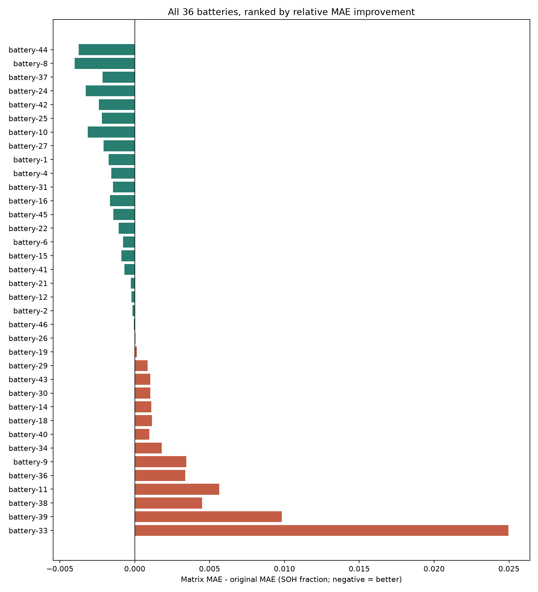
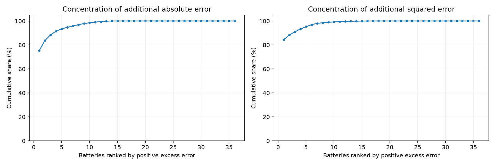
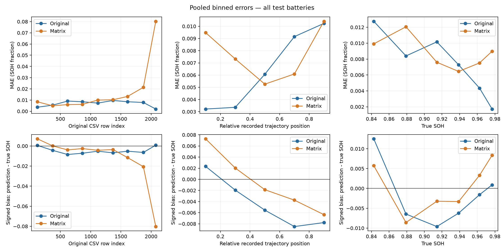
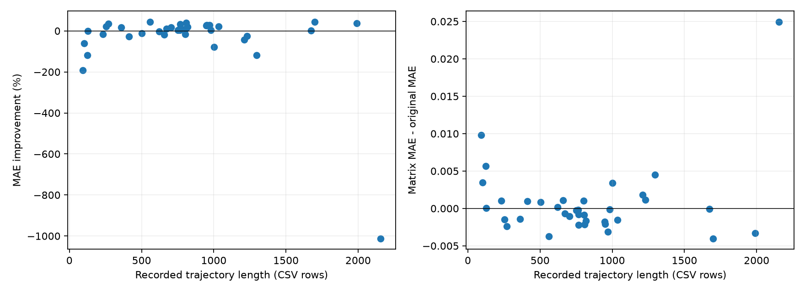
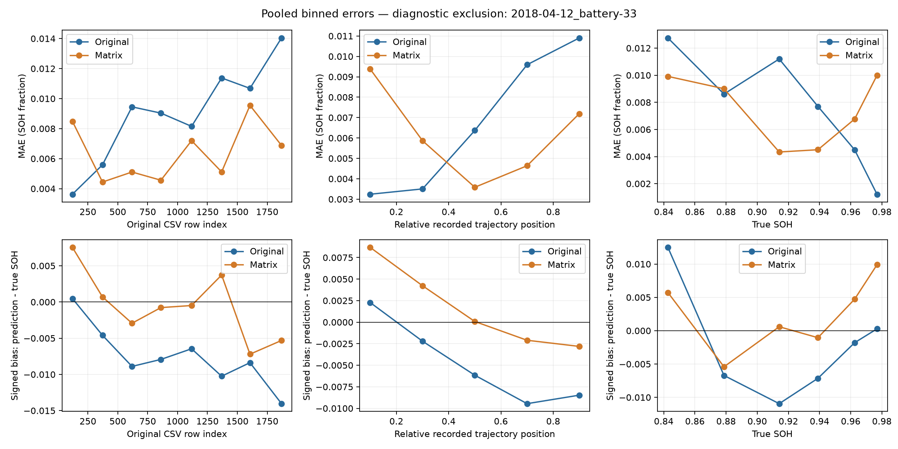
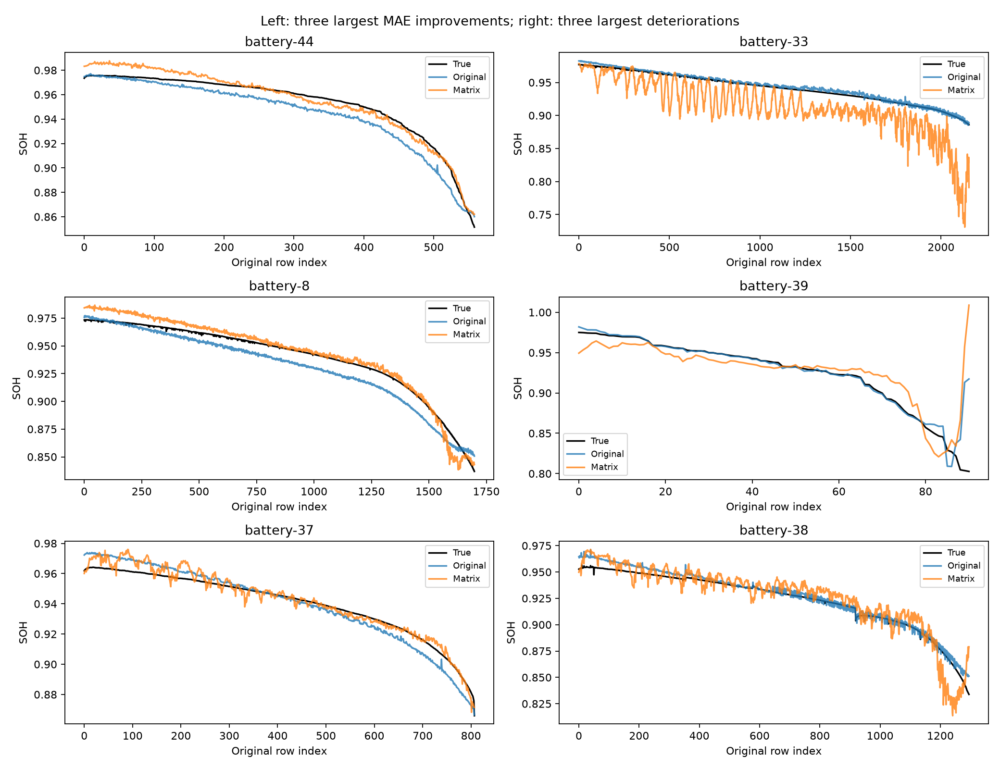
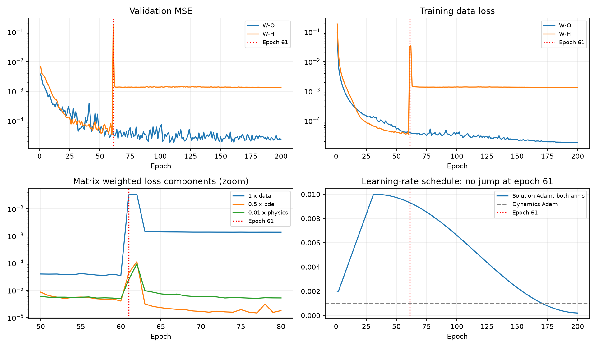

# Detailed Wang original vs matrix analysis

Date: 2026-10-14. Read-only analysis of existing seed-42 predictions and 200-epoch loss histories. No model changes, inference, retraining, or Zhang experiments.

## Main finding

The matrix model is **not broadly worse across batteries**: 21/36 improve in MAE and 15/36 worsen; median battery-level relative improvement is 3.45%. Its pooled performance is worse, with a concentrated tail of battery-specific failures and a separate training-instability event. The representation is potentially useful, but the present implementation needs validation-led investigation before any tuning claim.

This is one seed, one held-out date batch, and two different-capacity/history pipelines. It neither establishes statistical superiority nor identifies FFT as the cause.

## Definitions and evidence

Inputs: W-O/W-H seed_42/test_predictions.npz, loss_history.csv and metrics.json. Arrays are joined by identical battery_id/row_index/true-label sequences; all 29,083 keys are unique. Models were selected separately by validation, at epochs 111 (original) and 60 (matrix). SOH is capacity/1.1 as a fraction. MAE difference = matrix MAE - original MAE (negative is better). Ranking uses 100*(original MAE-matrix MAE)/original MAE, descending; it is not a ranking by absolute error contribution.

Trajectory length is the number of recorded CSV rows, not a verified end-of-life measurement. Relative position = original row index/(recorded rows-1), used only for retrospective analysis, never as a new model input. Histories may have different sampling/termination conditions.

## Top 10 improved most

| rank | battery | n | MAE_original | MAE_matrix | MAE_difference | MAE_improvement_percent |
| --- | --- | --- | --- | --- | --- | --- |
| 1 | 2018-04-12_battery-44 | 559 | 0.00841062 | 0.0046687 | -0.00374192 | 44.4904 |
| 2 | 2018-04-12_battery-8 | 1699 | 0.00923206 | 0.00521808 | -0.00401398 | 43.4787 |
| 3 | 2018-04-12_battery-37 | 808 | 0.00540652 | 0.00326248 | -0.00214404 | 39.6566 |
| 4 | 2018-04-12_battery-24 | 1990 | 0.00881801 | 0.00553402 | -0.00328399 | 37.2418 |
| 5 | 2018-04-12_battery-42 | 268 | 0.00697985 | 0.00457912 | -0.00240073 | 34.3952 |
| 6 | 2018-04-12_battery-25 | 766 | 0.00684469 | 0.00464798 | -0.00219672 | 32.0937 |
| 7 | 2018-04-12_battery-10 | 970 | 0.0108689 | 0.00772118 | -0.00314774 | 28.961 |
| 8 | 2018-04-12_battery-27 | 950 | 0.00752323 | 0.00545133 | -0.00207191 | 27.5401 |
| 9 | 2018-04-12_battery-1 | 946 | 0.00667847 | 0.00492706 | -0.00175141 | 26.2248 |
| 10 | 2018-04-12_battery-4 | 1034 | 0.0069533 | 0.00539788 | -0.00155542 | 22.3695 |

## Top 10 worsened most

| rank | battery | n | MAE_original | MAE_matrix | MAE_difference | MAE_improvement_percent |
| --- | --- | --- | --- | --- | --- | --- |
| 36 | 2018-04-12_battery-33 | 2155 | 0.00246583 | 0.0274202 | 0.0249544 | -1012.01 |
| 35 | 2018-04-12_battery-39 | 91 | 0.005151 | 0.0149835 | 0.00983246 | -190.885 |
| 34 | 2018-04-12_battery-38 | 1296 | 0.00377085 | 0.00827974 | 0.00450889 | -119.572 |
| 33 | 2018-04-12_battery-11 | 123 | 0.00471643 | 0.0103555 | 0.00563904 | -119.562 |
| 32 | 2018-04-12_battery-36 | 1002 | 0.00426953 | 0.00764981 | 0.00338028 | -79.1723 |
| 31 | 2018-04-12_battery-9 | 100 | 0.00565238 | 0.00909791 | 0.00344553 | -60.9572 |
| 30 | 2018-04-12_battery-34 | 1209 | 0.00426618 | 0.00606257 | 0.00179639 | -42.1075 |
| 29 | 2018-04-12_battery-40 | 411 | 0.00363443 | 0.00461504 | 0.00098061 | -26.9811 |
| 28 | 2018-04-12_battery-18 | 1228 | 0.00448439 | 0.00564244 | 0.00115805 | -25.824 |
| 27 | 2018-04-12_battery-14 | 657 | 0.00632994 | 0.00743497 | 0.00110502 | -17.4571 |

## All 36 ranked by MAE improvement

| rank | battery | n | MAE_original | MAE_matrix | MAE_difference | MAE_improvement_percent |
| --- | --- | --- | --- | --- | --- | --- |
| 1 | 2018-04-12_battery-44 | 559 | 0.00841062 | 0.0046687 | -0.00374192 | 44.4904 |
| 2 | 2018-04-12_battery-8 | 1699 | 0.00923206 | 0.00521808 | -0.00401398 | 43.4787 |
| 3 | 2018-04-12_battery-37 | 808 | 0.00540652 | 0.00326248 | -0.00214404 | 39.6566 |
| 4 | 2018-04-12_battery-24 | 1990 | 0.00881801 | 0.00553402 | -0.00328399 | 37.2418 |
| 5 | 2018-04-12_battery-42 | 268 | 0.00697985 | 0.00457912 | -0.00240073 | 34.3952 |
| 6 | 2018-04-12_battery-25 | 766 | 0.00684469 | 0.00464798 | -0.00219672 | 32.0937 |
| 7 | 2018-04-12_battery-10 | 970 | 0.0108689 | 0.00772118 | -0.00314774 | 28.961 |
| 8 | 2018-04-12_battery-27 | 950 | 0.00752323 | 0.00545133 | -0.00207191 | 27.5401 |
| 9 | 2018-04-12_battery-1 | 946 | 0.00667847 | 0.00492706 | -0.00175141 | 26.2248 |
| 10 | 2018-04-12_battery-4 | 1034 | 0.0069533 | 0.00539788 | -0.00155542 | 22.3695 |
| 11 | 2018-04-12_battery-31 | 253 | 0.00708283 | 0.00561978 | -0.00146304 | 20.6562 |
| 12 | 2018-04-12_battery-16 | 818 | 0.00843447 | 0.00678835 | -0.00164613 | 19.5167 |
| 13 | 2018-04-12_battery-45 | 359 | 0.00786542 | 0.0064263 | -0.00143912 | 18.2968 |
| 14 | 2018-04-12_battery-22 | 704 | 0.00639747 | 0.00533055 | -0.00106693 | 16.6773 |
| 15 | 2018-04-12_battery-6 | 767 | 0.00628903 | 0.00551026 | -0.000778769 | 12.383 |
| 16 | 2018-04-12_battery-15 | 804 | 0.00887838 | 0.00798704 | -0.000891335 | 10.0394 |
| 17 | 2018-04-12_battery-41 | 671 | 0.00715024 | 0.0064528 | -0.000697443 | 9.75412 |
| 18 | 2018-04-12_battery-21 | 750 | 0.00661595 | 0.00635735 | -0.0002586 | 3.90873 |
| 19 | 2018-04-12_battery-12 | 762 | 0.0072197 | 0.00700359 | -0.000216115 | 2.9934 |
| 20 | 2018-04-12_battery-2 | 980 | 0.00550814 | 0.00535283 | -0.000155313 | 2.8197 |
| 21 | 2018-04-12_battery-46 | 1673 | 0.00626214 | 0.00619983 | -6.23104e-05 | 0.995033 |
| 22 | 2018-04-12_battery-26 | 126 | 0.00706628 | 0.00712724 | 6.09585e-05 | -0.862668 |
| 23 | 2018-04-12_battery-19 | 621 | 0.00443902 | 0.00458675 | 0.000147725 | -3.32786 |
| 24 | 2018-04-12_battery-29 | 502 | 0.0072968 | 0.00816823 | 0.000871429 | -11.9426 |
| 25 | 2018-04-12_battery-43 | 230 | 0.0064946 | 0.00752432 | 0.00102972 | -15.855 |
| 26 | 2018-04-12_battery-30 | 801 | 0.00651794 | 0.00756426 | 0.00104631 | -16.0528 |
| 27 | 2018-04-12_battery-14 | 657 | 0.00632994 | 0.00743497 | 0.00110502 | -17.4571 |
| 28 | 2018-04-12_battery-18 | 1228 | 0.00448439 | 0.00564244 | 0.00115805 | -25.824 |
| 29 | 2018-04-12_battery-40 | 411 | 0.00363443 | 0.00461504 | 0.00098061 | -26.9811 |
| 30 | 2018-04-12_battery-34 | 1209 | 0.00426618 | 0.00606257 | 0.00179639 | -42.1075 |
| 31 | 2018-04-12_battery-9 | 100 | 0.00565238 | 0.00909791 | 0.00344553 | -60.9572 |
| 32 | 2018-04-12_battery-36 | 1002 | 0.00426953 | 0.00764981 | 0.00338028 | -79.1723 |
| 33 | 2018-04-12_battery-11 | 123 | 0.00471643 | 0.0103555 | 0.00563904 | -119.562 |
| 34 | 2018-04-12_battery-38 | 1296 | 0.00377085 | 0.00827974 | 0.00450889 | -119.572 |
| 35 | 2018-04-12_battery-39 | 91 | 0.005151 | 0.0149835 | 0.00983246 | -190.885 |
| 36 | 2018-04-12_battery-33 | 2155 | 0.00246583 | 0.0274202 | 0.0249544 | -1012.01 |

## Are the pooled errors driven by a small subset?

Largest contributor to excess absolute error: **2018-04-12_battery-33**, accounting for 75.4% of positive excess absolute error. The top three account for 88.4%. The largest battery contributes 141.1% of NET excess error; a share over 100% is possible because other batteries offset that loss.

Contribution = sum over a battery of (absolute matrix error - absolute original error). This equals sample count times its MAE difference. Squared-error concentration is shown separately. Percentage improvements on a low-error battery can be very large without dominating the total.

| battery | n | excess_absolute_error | share_positive_excess_abs_percent | share_net_excess_abs_percent | excess_squared_error |
| --- | --- | --- | --- | --- | --- |
| 2018-04-12_battery-33 | 2155 | 53.7767 | 75.4497 | 141.14 | 2.79099 |
| 2018-04-12_battery-38 | 1296 | 5.84352 | 8.19857 | 15.3367 | 0.126532 |
| 2018-04-12_battery-36 | 1002 | 3.38704 | 4.75208 | 8.8895 | 0.0882259 |
| 2018-04-12_battery-34 | 1209 | 2.17183 | 3.04712 | 5.7001 | 0.0644522 |
| 2018-04-12_battery-18 | 1228 | 1.42208 | 1.99521 | 3.73234 | 0.0350026 |

### Post-hoc exclusion sensitivity — diagnostic only

Remove the top contributors to excess absolute error from BOTH arms, using the same remaining samples. These are deliberately outcome-selected exclusions, not replacement headline results and not permission to remove difficult batteries from future evaluation. o=original; h=matrix.

| excluded_count | arm | n | MAE | MAPE_percent | RMSE | MSE |
| --- | --- | --- | --- | --- | --- | --- |
| 0 | o | 29083 | 0.00640118 | 0.688278 | 0.00802262 | 6.43625e-05 |
| 0 | h | 29083 | 0.00771128 | 0.82435 | 0.0125325 | 0.000157065 |
| 1 | o | 26928 | 0.00671612 | 0.722404 | 0.00829535 | 6.88128e-05 |
| 1 | h | 26928 | 0.00613401 | 0.654367 | 0.00808005 | 6.52873e-05 |
| 3 | o | 24630 | 0.00697063 | 0.749609 | 0.00853995 | 7.29307e-05 |
| 3 | h | 24630 | 0.00595944 | 0.634037 | 0.00776897 | 6.03569e-05 |
| 5 | o | 22193 | 0.00725553 | 0.780364 | 0.0088237 | 7.78577e-05 |
| 5 | h | 22193 | 0.00597136 | 0.634289 | 0.00770855 | 5.94218e-05 |

## Error versus cycle index, SOH and recorded length

Plots show pooled MAE and signed bias (prediction minus true SOH); negative bias means underprediction. Bins are descriptive, not new training thresholds. Counts and equal-battery-within-bin averages are included in the CSVs to expose unequal trajectory coverage. Very late absolute-cycle bins contain few long batteries; SOH, length and age are correlated, so these curves do not prove causation.

| bin | n | batteries | o_MAE | h_MAE | o_bias | h_bias |
| --- | --- | --- | --- | --- | --- | --- |
| [0.0, 0.2) | 5839 | 36 | 0.00321925 | 0.00947815 | 0.00232741 | 0.00728094 |
| [0.2, 0.4) | 5817 | 36 | 0.0033567 | 0.00732275 | -0.00194256 | 0.00203574 |
| [0.4, 0.6) | 5815 | 36 | 0.00606541 | 0.00525845 | -0.00554147 | -0.00186508 |
| [0.6, 0.8) | 5817 | 36 | 0.0091548 | 0.00609123 | -0.0084951 | -0.00374136 |
| [0.8, 1.0) | 5795 | 36 | 0.0102362 | 0.0104085 | -0.00777981 | -0.0063539 |

The pattern is mixed: matrix MAE is worse in the first 20% of the recorded trajectory for **34/36 batteries**, but in the final 20% for only **13/36**. Pooled early MAE rises from 0.003219 to 0.009478, with positive matrix bias +0.007281 (overprediction). This broad early bias remains after excluding battery 33. In the final 20%, pooled MAE is nearly tied (0.010236 original versus 0.010408 matrix); excluding battery 33 diagnostically changes this to 0.010903 versus 0.007192. Thus the catastrophic tail is concentrated, while an early/high-SOH weakness is widespread.

There is no uniform low-SOH failure: matrix MAE improves in the 0.80–0.85 band but worsens in 0.85–0.90. The lowest band contains only 307 samples from 24 batteries; its improved MAE does not imply improved RMSE. At high SOH (0.975 and above), matrix MAE rises from 0.001719 to 0.008980, with positive bias +0.008354. Recorded length shows only weak correlation with the improvement, so longer trajectories alone do not explain the failures.

### SOH bands

| bin | n | batteries | o_MAE | h_MAE | o_bias | h_bias |
| --- | --- | --- | --- | --- | --- | --- |
| [0.8, 0.85) | 307 | 24 | 0.0127473 | 0.00991439 | 0.0124984 | 0.00573004 |
| [0.85, 0.9) | 2830 | 36 | 0.0083936 | 0.0120609 | -0.00645163 | -0.00859072 |
| [0.9, 0.925) | 3841 | 36 | 0.0101632 | 0.00760034 | -0.0096074 | -0.00322285 |
| [0.925, 0.95) | 8565 | 36 | 0.00726953 | 0.00644505 | -0.00621619 | -0.00330225 |
| [0.95, 0.975) | 12916 | 36 | 0.00434539 | 0.00751727 | -0.00158176 | 0.00332361 |
| [0.975, 1.001) | 624 | 7 | 0.00171928 | 0.00897977 | 0.000899118 | 0.0083543 |

Within-battery late-vs-early check: 7/36 batteries have a greater matrix-minus-original MAE difference in the last 20% than in the first 20% of their recorded trajectory. This complements the pooled curves; it does not equate late-recording with a common physical age.

Battery-level Spearman correlation of length with MAE improvement: 0.139; with MAE difference: -0.161. This is descriptive across 36 correlated-condition batteries, not a hypothesis-test result.

Profiles with only 2018-04-12_battery-33 excluded diagnose how strongly it affects the apparent low-SOH/late-cycle pattern. They do not change the official results.

## Epoch-61 spike: what the saved evidence supports

| epoch | lr_used | data | pde | physics | validation_MSE |
| --- | --- | --- | --- | --- | --- |
| 58 | 0.00944519 | 3.54952e-05 | 9.3833e-06 | 0.000528289 | 4.86372e-05 |
| 59 | 0.0094026 | 3.90768e-05 | 9.63725e-06 | 0.000518377 | 8.15126e-05 |
| 60 | 0.00935854 | 3.48542e-05 | 8.05321e-06 | 0.000491985 | 3.31991e-05 |
| 61 | 0.00931302 | 0.03264 | 8.66864e-05 | 0.00250286 | 0.186728 |
| 62 | 0.00926606 | 0.034096 | 0.000225513 | 0.00945412 | 0.00142346 |
| 63 | 0.00921769 | 0.00146909 | 6.32827e-06 | 0.000972823 | 0.00137894 |
| 64 | 0.0091679 | 0.00143145 | 5.124e-06 | 0.000855377 | 0.00137235 |

Epoch 61 training data loss rises 936.5x versus epoch 60; validation MSE rises 5624.5x. After warmup (epochs >30), validation jumps greater than 5x over the previous epoch occur at [61]. This declared descriptive threshold separates large shocks from ordinary fluctuations.

It is an isolated large onset, **not an isolated harmless one-epoch outlier**: training data loss is still high at epoch 62, and validation settles on a worse plateau. Final validation MSE is 41.1x the best at epoch 60; it never recovers that best during epochs 61–200.

The solution LR is smoothly decreasing near the event, not being increased or restarted. The warmup/peak transition occurs around epochs 30–32, not 61. Both arms have identical saved LR sequences; dynamics LR remains 0.001. Adam runs continuously without an epoch-61 reset, gradient clipping or special branch in the saved runner. The relatively high LR, large input layer, dropout, minibatch order and Adam dynamics are plausible interacting factors, but the logs cannot identify which caused the jump.

The checkpoints save model states, not Adam moments or per-step gradients. Epoch-aggregated losses cannot locate the offending minibatch or distinguish a large update from input/batch effects. Do not call this a confirmed optimizer bug. A later authorized diagnosis could log gradient/update norms around a replay, but no replay was performed here.

Crucially, the matrix test predictions analyzed here come from **epoch 60, before the spike**. The later spike therefore cannot directly cause these saved test errors. It prevented a demonstrated later recovery in this run, but is a separate warning about training stability. Its association with validation degradation is direct; its causal explanation is unproven.

## Recommendation

Classify this as **potentially useful, with concentrated severe failures, widespread early/high-SOH bias, and training instability requiring investigation**, rather than broadly inferior on every battery. First inspect the largest-error trajectories and validation-side analogues; then, if authorized, design a controlled training-stability/representation ablation using validation only. Do not tune to the already-inspected test batteries or discard them. No model changes or further training are recommended as an automatic continuation of this analysis.

## Files

wang_detailed/ contains full ranking, top/bottom tens, additive error contributions, exclusion sensitivity, binned errors (including battery-balanced columns), epoch55–70 history, statistics and seven diagnostic plot families. Original prediction/checkpoint/metrics files remain unchanged.
